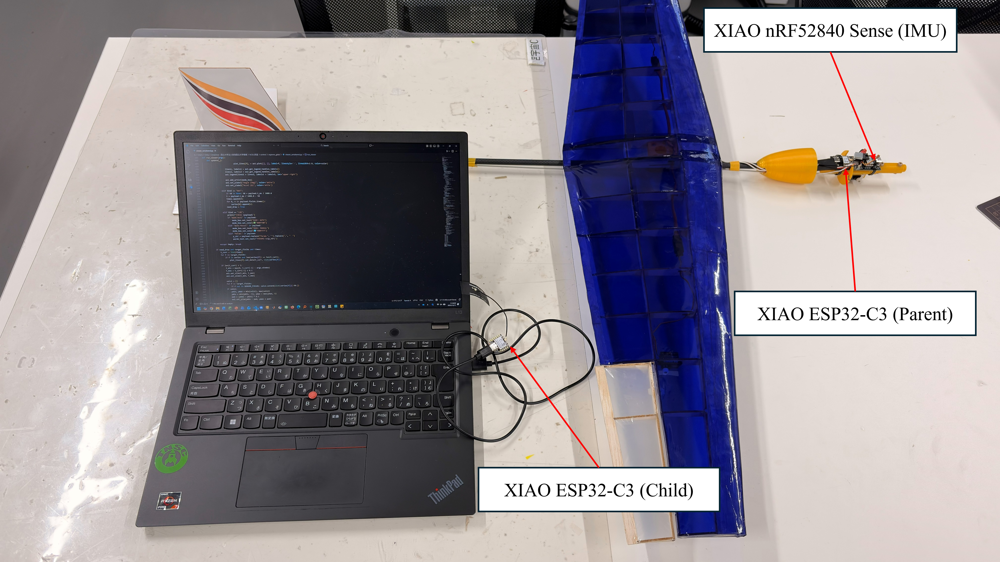
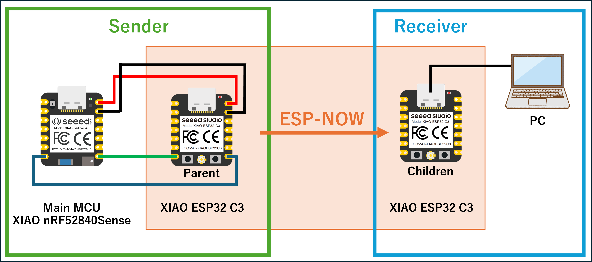
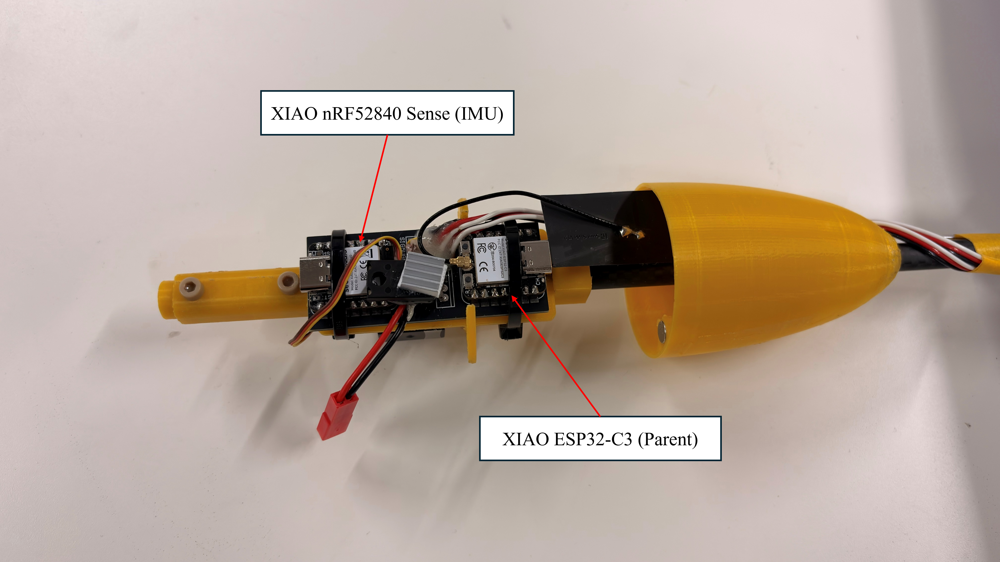

# NCSU-Flight-Control-System

[English](README_en.md) | [日本語](README.md)

このリポジトリは、[`espnow-uart-bridge`](https://github.com/sassa4771/espnow-uart-bridge) をベースにした、  
**小型機体（グライダー等）向け IMU ベース飛行制御 + テレメトリ取得システム**です。

- 機体側の **IMU/サーボ制御 MCU**（Seeed XIAO nRF52840 Sense / `imu_control`）
- 無線ブリッジ用の **ESP32 親機・子機**（ESP-NOW UART ブリッジ）
- PC 側の **Python ビューア / ログ保存スクリプト**

から構成され、IMU データ・姿勢角・サーボ角・ログメッセージを **CSV 形式のテキスト (`HDR` / `DAT` / `LOG`)** として  
PC にストリーミングします。

このプロジェクトは、[espnow-uart-bridge](https://github.com/sassa4771/espnow-uart-bridge) をベースとして、ESP-NOW による無線通信ブリッジ機能を実装しています。

---

## 構成

- **`firmware/`**
  - 機体および無線ブリッジ用の Arduino / ESP32 スケッチ
  - **IMU 制御 MCU**
    - `imu_control/imu_control.ino`  
      Seeed XIAO nRF52840 Sense 用。IMU（LSM6DS3）+ MadgwickAHRS による姿勢推定と  
      PID による 3ch サーボ制御、`HDR` / `DAT` / `LOG` 出力を担当。
  - **ESP-NOW ブリッジ**
    - `parent_uart_bridge/parent_uart_bridge.ino`  
      機体側 ESP32。XIAO からの `HDR` / `DAT` / `LOG` 行をパースして ESP-NOW に変換し、子機へ送信。  
      子機からのコマンド（0xFE + 1 文字）を UART 経由で XIAO に中継。
    - `child_uart_bridge/child_uart_bridge.ino`  
      地上側（PC 接続）ESP32。ESP-NOW パケットを受信して `HDR` / `DAT` / `LOG` 行として PC に出力。  
      PC からのキー入力（改行以外）を、親機へそのまま転送。

- **`host/python/`**
  - PC 側でシリアルポートから `HDR` / `DAT` / `LOG` 行を受信し、ログ保存や可視化・コマンド送信を行う Python スクリプト群
  - `logger_gui.py`: PySide6 による測定ダッシュボード GUI（2系統シリアル、カメラ撮影、リアルタイムグラフ、姿勢数値表示、CSV記録）
  - `main_logger.py`: 軽量なヘッドレス CLI ロガー（シリアル受信 + 定期カメラ撮影 + CSVログ保存）
  - `live_plot_from_csv.py`: 保存済み CSV ログのリアルタイム追従プロッタ
  - `viewer_serialsend.py`: リアルタイム姿勢・テレメトリ表示 & 機体へのシリアルコマンド送信ビューア

- **`assets/`**
  - 3D モデルなどのアセット配置ディレクトリ
  - `models/TCS_Best_Machine.obj` - 機体 3D モデルデータ (OBJ 形式)

- **`docs/`**
  - 実験メモや図版などを配置するディレクトリ
  - `equipment_configuration.png` - システム全体の機器構成図
  - `wiring_diagram.png` - XIAO と親機 ESP32 の配線図、ESP-NOW 通信の概要
  - `detail_board.png` - XIAO nRF52840 Sense のボード詳細図（ピン配置と接続例）
  - `demo.mp4` - システム動作デモ動画

---

## 全体アーキテクチャ / データフロー

*機器構成図: 機体側（XIAO + 親機 ESP32）と地上側（子機 ESP32 + PC）の接続構成*

1. **機体側 IMU 制御 MCU（XIAO nRF52840 Sense）**
   - スケッチ: `firmware/imu_control/imu_control.ino`
   - IMU（LSM6DS3）からの **加速度 / 角速度** を `MadgwickAHRS` で **Roll / Pitch / Yaw** に変換。
   - PID 制御で 3ch サーボ（左右翼 + エレベータ）を駆動。
   - `Serial1` を介して UART で双方向通信します（送信・受信）:
     - **送信**: 以下のテキスト行を親機 ESP32 へ送信
       - `HDR,1,GLDR,fields=dt_ms,ax,ay,az,gx,gy,gz,roll,pitch,yaw,s0,s1,s2,rate=30`
       - `DAT,<seq>,<t_ms>,<dt_ms>,ax,ay,az,gx,gy,gz,roll,pitch,yaw,s0,s1,s2`
       - 必要に応じて `LOG,...` 行（パラメータ変更・モード変更などのログ）
     - **受信**: PC からのコマンド（1 文字）を親機経由で受信し、`processCommand()` で処理

2. **機体側 ESP32（親機ブリッジ）**
   - スケッチ: `firmware/parent_uart_bridge/parent_uart_bridge.ino`
   - XIAO と UART で双方向通信します:
     - **受信**: XIAO から受信した行を 1 行ずつパースし、ESP-NOW のバイナリフレームに変換
       - `HDR, ...` → `FT_HDR` パケット
       - `DAT, ...` → `FT_DATA` パケット
       - `LOG, ...` → `FT_LOG` パケット
     - **送信**: 子機からの `0xFE, <cmd>` を UART 経由で XIAO に転送し、`processCommand()` に渡します
   - キューとフロー制御（`Q_CAP` / `MAX_INFLIGHT`）により、連続 30Hz のデータを安定して送信します。

3. **地上側 ESP32（子機ブリッジ）**
   - スケッチ: `firmware/child_uart_bridge/child_uart_bridge.ino`
   - 親機からの ESP-NOW フレームを受信し、CRC 検証のうえ
     - `FT_HDR` → `HDR,1,GLDR,fields=...`
     - `FT_DATA` → `DAT,src_seq,t_ms,val0,val1,...`
     - `FT_LOG` → `LOG,...`
     として PC にシリアル出力。
   - PC からのキー入力を読み取り、改行以外の 1 文字をすべて `0xFE, c` の 2 バイトとして親機へ送信。

4. **PC 側**
   - `host/python/viewer_serialsend.py` や `logger_gui.py` などで子機のシリアルポートを開き、  
     流れてくる `HDR` / `DAT` / `LOG` 行をそのまま **CSV として保存・可視化**。
   - キーボードや GUI から `A`, `M`, `P`, `L`, `R`, `E` などの 1 文字を送ることで、  
     飛行モードや PID ゲイン、トリム等を機体側でオンザフライ変更可能。

---

## Quick Start（クイックスタート）

### 前提条件: ESP32 ボードマネージャのバージョン

**重要**: ESP32 の[ボードマネージャ](https://github.com/espressif/arduino-esp32) でインストールするプロファイルは、**ver.2.0.14 または 2.0.xx 系**でないと動作しません。  
Arduino IDE の「ツール」→「ボード」→「ボードマネージャ」で、ESP32 のバージョンを確認し、必要に応じて 2.0.14 にダウングレードしてください。

### 1. 子機 ESP32（PC 側）を用意

1. Arduino IDE で、PC 接続側の ESP32 ボードを選択（例: `ESP32 Dev Module`）。  
   **ESP32 ボードマネージャは ver.2.0.14 または 2.0.xx 系を使用してください。**
2. `firmware/child_uart_bridge/child_uart_bridge.ino` を開き、以下を設定:
   - `const int CHANNEL = 1;`  
     親機と同じチャネルを使用（例として 1 を推奨）。
   - `parentMac[]` に **親機 ESP32 の STA MAC アドレス** を設定  
     （不明な場合、一旦 `{0xFF,...}` のブロードキャストで動作確認も可能）。
3. ボードに書き込み、USB で PC に接続。
4. シリアルモニタを **115200bps** で開いた状態にしておく。

### 2. 親機 ESP32（機体側ブリッジ）をセットアップ

1. 機体側 ESP32 用にボードを選択。  
   **ESP32 ボードマネージャは ver.2.0.14 または 2.0.xx 系を使用してください。**
2. `firmware/parent_uart_bridge/parent_uart_bridge.ino` を開き、以下を設定:
   - `const int CHANNEL = 1;`  
     子機と同じチャネルにする。
   - `const uint8_t peerMac[6] = {...};`  
     **子機 ESP32 の STA MAC アドレス** を設定（`WiFi.macAddress()` などで取得）。
3. XIAO と ESP32 親機を UART で双方向接続:
   - XIAO `Serial1` TX → 親機 `UART_RX_PIN`（デフォルト: `D7` / GPIO20）
   - XIAO `Serial1` RX → 親機 `UART_TX_PIN`（デフォルト: `D6` / GPIO21）
   - GND 共通
   - 460800bps / 8N1 で双方向通信（高速転送用）
   - 注意: UART は双方向通信のため、TX と RX の両方を接続する必要があります。

*配線図: XIAO nRF52840 Sense と親機 ESP32 の UART 双方向接続（TX/RX 両方向）、および親機・子機間の ESP-NOW 無線通信*

4. 親機 ESP32 にスケッチを書き込み。

### 3. IMU 制御 MCU（XIAO nRF52840 Sense）側

1. Arduino IDE でボードを **Seeed XIAO nRF52840 Sense** に設定。
2. 必要ライブラリをインストール:
   - `LSM6DS3`
   - `MadgwickAHRS`
   - `Servo`
3. `firmware/imu_control/imu_control.ino` を開き、XIAO に書き込み。
4. XIAO の UART（`Serial1`）と親機 ESP32 の UART を双方向接続で配線:
   - XIAO `Serial1` TX → 親機 `UART_RX_PIN`（デフォルト: `D7` / GPIO20）
   - XIAO `Serial1` RX → 親機 `UART_TX_PIN`（デフォルト: `D6` / GPIO21）
   - GND 共通
   - 注意: UART は双方向通信のため、TX と RX の両方を接続する必要があります。

### 4. PC 側でログを確認

1. 子機 ESP32 を PC に接続している状態で、
   - Arduino IDE のシリアルモニタ、または
   - `host/python/viewer_serialsend.py` や `host/python/logger_gui.py`
   を **115200bps** で起動。
2. 機体側（XIAO + 親機 ESP32）の電源を入れる。
3. 数秒以内に
   - 先頭に 1 回 `HDR,1,GLDR,fields=...`
   - 以降 30Hz 程度で `DAT,...`
   - 所々に `LOG,...`
   が流れてくる。
4. PC 側で `A`, `M` などの 1 文字をタイプすると、そのまま機体側の `imu_control` へコマンドとして届きます。

### デモ動画

システムの動作デモ動画をご覧いただけます:

https://github.com/user-attachments/assets/fcdf980d-268f-4e5b-b416-96dcf80344d7

*デモ動画: システム全体の動作を確認できます。機体側（XIAO + 親機 ESP32）の電源投入から、PC 側でのデータ受信、リアルタイムでのコマンド送信（モード切り替え、PID ゲイン調整など）まで、実際の動作を視覚的に確認できます。*

---

## IMU 制御 MCU（`imu_control.ino`）の詳細

*ボード詳細図: Seeed XIAO nRF52840 Sense のピン配置と接続例*

- **ボード**: Seeed XIAO nRF52840 Sense
- **主な機能**:
  - LSM6DS3 の加速度 / ジャイロから Madgwick フィルタで姿勢角を推定。
  - ロール・ピッチに対する PID 制御で 3ch サーボを駆動。
  - 自動モード（Auto）では、発射検知とロールゲインのブースト機能を持つ。
  - ステータスやパラメータは `LOG,...` 行として出力し、PC 側から確認可能。

### データ出力フォーマット

- **ヘッダ（起動時に 1 回）**
  - `HDR,1,GLDR,fields=dt_ms,ax,ay,az,gx,gy,gz,roll,pitch,yaw,s0,s1,s2,rate=30`

- **データ行（ループごと、約 30Hz）**
  - `DAT,seq,t_ms,dt_ms,ax,ay,az,gx,gy,gz,roll,pitch,yaw,s0,s1,s2`
  - `seq`: 送信ごとの通し番号
  - `t_ms`: `millis()` による時刻 [ms]
  - `dt_ms`: 前回送信からの経過時間 [ms]
  - `ax,ay,az`: 加速度 [g]
  - `gx,gy,gz`: 角速度 [deg/s]
  - `roll,pitch,yaw`: 姿勢角 [deg]
  - `s0,s1,s2`: 各サーボ角 [deg]

- **ログ行**
  - 例: `LOG,mode:Manual`, `LOG,Launch Detected!`, `LOG,Boost: Roll Gains Doubled!` など

### モードと自動ブースト

- **Manual モード (`mode=2`)**
  - トリム角 `ang_trim[]` をそのままサーボに出力。
  - IMU の姿勢推定は継続するが、制御には用いない。

- **Auto モード (`mode=1`)**
  - 発射検知:
    - 加速度 `acc_.x` が `LAUNCH_THRESHOLD`（例: -3.0）未満になった時に Launch 判定。
  - ゲインブースト:
    - 発射後、`BOOST_DELAY_MS` 経過したらロール用 PID ゲインを 2 倍にする。
    - ブースト時に `LOG,Boost: Roll Gains Doubled!` を出力。

---

## IMU 制御用コマンド一覧（PC から 1 文字送信）

`child_uart_bridge` を経由して PC から 1 文字を送ると、  
`imu_control` の `processCommand(char c)` に渡され、パラメータやモードを変更できます。

### モード切り替え

- **`A` / `a`**: Auto モードに切り替え（発射待ち状態にリセット）
- **`M` / `m`**: Manual モードに切り替え

### PID ゲイン調整（ピッチ）

- **`P` / `p`**: `kp_pit` （ピッチ P ゲイン）増減（±0.1）
- **`D` / `d`**: `kd_pit` （ピッチ D ゲイン）増減（±0.1）
- **`I` / `i`**: `ki_pit` （ピッチ I ゲイン）増減（±0.01）

### PID ゲイン調整（ロール）

- **`X` / `x`**: `kp_rol` 増減（±0.1）
- **`Y` / `y`**: `kd_rol` 増減（±0.1）
- **`Z` / `z`**: `ki_rol` 増減（±0.01）

### 目標ピッチ角

- **`G` / `g`**: `ang_goal`（目標ピッチ角 [deg]）の増減（±1）

### トリム調整（L/R/E）

- **`L` / `l`**: 左翼サーボのトリム角（`ang_trim[0]`）±1°
- **`R` / `r`**: 右翼サーボのトリム角（`ang_trim[1]`）±1°
- **`E` / `e`**: エレベータサーボのトリム角（`ang_trim[2]`）±1°

### その他

- **`C` / `c`**: 3 つのトリム角をすべて 90° にリセット
- **`S` / `s`**: 現在の PID・トリム値を、ソースコード断片としてシリアルに出力（コピー＆ペースト用）
- **`H` / `h`**: シーケンス番号 `seq` をリセットし、`HDR` 行と現在パラメータ (`LOG,Param:...`) を再送信

---

## プロトコル概要（`espnow-uart-bridge` 由来）

### UART（テキスト）側

- **ヘッダ**
  - `HDR,1,GLDR,fields=<カンマ区切りフィールド名>[,rate=…]`
- **データ**
  - `DAT,<src_seq>,<t_ms>,<values...>`
- **ログ**
  - `LOG,<自由形式テキスト...>`

本プロジェクトでは `imu_control` が `HDR` / `DAT` / `LOG` を生成し、  
親機・子機はこれを **ほぼそのままの形で PC に届ける** 役割です。

### 無線（ESP-NOW, バイナリ）側

- `NowFrameHdr{ ver=1, type(1=HDR/2=DATA/3=HB/4=LOG), node_id, tx_seq, payload_len, crc16 }`
- `HDR payload{ schema_id(FNV-1a 16bit), fields_len, fields[] }`
- `DATA payload{ schema_id, src_seq, t_ms, value_count, float[value_count] }`
- `LOG payload{ ログ文字列 }`

子機は CRC16-CCITT で検証し、テキスト形式に再構成して `Serial.println` します。

---

## トラブルシューティングのヒント

- **ESP32 のスケッチがコンパイルエラーになる / 動作しない**
  - **ESP32 ボードマネージャのバージョンを確認してください。ver.2.0.14 または 2.0.xx 系でないと動作しません。**  
    Arduino IDE の「ツール」→「ボード」→「ボードマネージャ」で、ESP32 のバージョンを確認し、必要に応じて 2.0.14 にダウングレードしてください。

- **何も表示されない**
  - 親機がまだ `HDR` を取得していない場合、数秒待つと自動的に `HDR` が再送される想定です。
  - UART 配線（TX→RX, RX→TX の双方向接続、GND 共通）とボーレート（115200bps）を確認してください。

- **データが途切れる / 途切れ途切れになる**
  - ESP-NOW のチャネル干渉の可能性。Wi-Fi が少ないチャネルに変更してみてください（例: 1, 6, 11）。
  - 親機のログ（`[STAT]` / `[REINIT]` に相当する部分）をシリアルで確認。

- **MAC アドレス周りでつまずく**
  - `peerMac` は **子機の STA MAC** を使う必要があります（AP MAC ではない）。
  - Wi-Fi の初期化順序: `WiFi.mode(WIFI_STA)` → `esp_wifi_start()` → `esp_wifi_set_channel()` → `esp_now_init()` → `esp_now_add_peer()` の順を守る。

より詳細な設計思想や背景については、元プロジェクト [`espnow-uart-bridge`](https://github.com/sassa4771/espnow-uart-bridge) の  
`README_ja.md` や `docs/overview.md` も参考になります。

---

## クレジット・謝辞

- **[espnow-uart-bridge](https://github.com/sassa4771/espnow-uart-bridge)** - ESP-NOW UART ブリッジの実装を提供
- **Espressif Systems** - ESP-NOW および ESP-IDF / Arduino-ESP32 を提供
- **Arduino-ESP32 コアメンテナー** - ESP32 Arduino コアのメンテナンス
- **Seeed Studio** - XIAO ESP32-C3 ボードサポートとドキュメント
