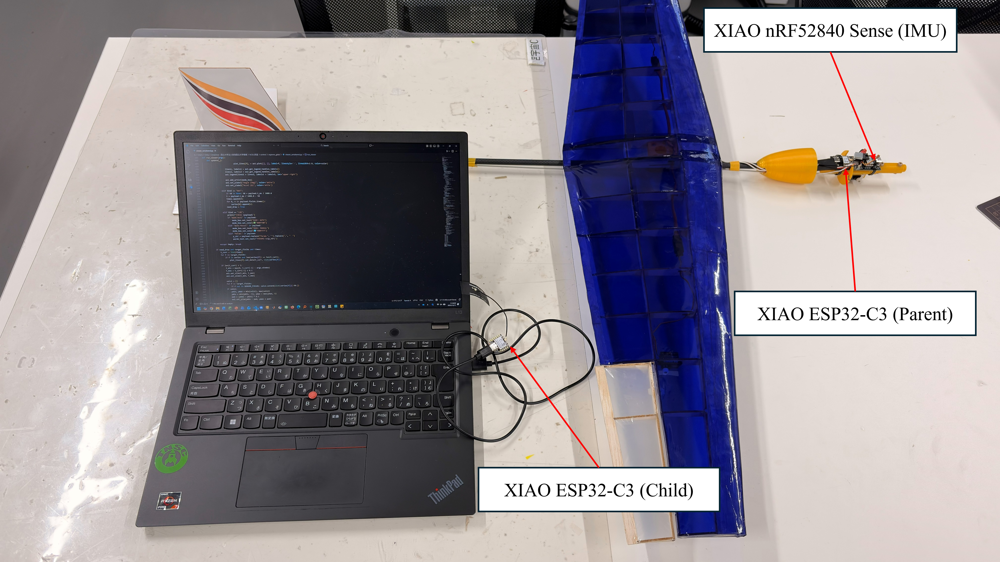
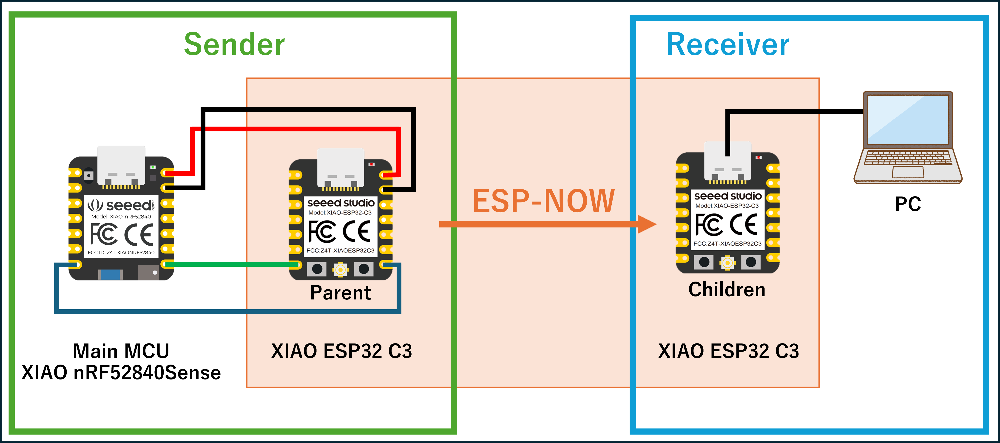
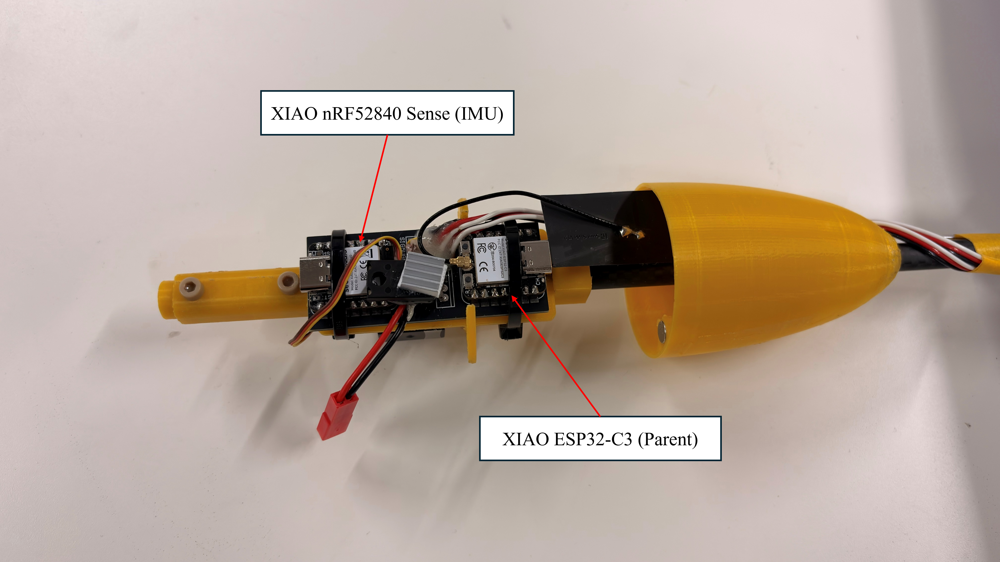

# NCSU-Flight-Control-System

[English](README_en.md) | [日本語](README.md)

This repository provides an **IMU-based flight control and telemetry acquisition system for small aircraft (such as gliders)**, based on [`espnow-uart-bridge`](https://github.com/sassa4771/espnow-uart-bridge).

The system consists of:
- **Onboard IMU/Servo Control MCU** (Seeed XIAO nRF52840 Sense / `imu_control`)
- **ESP32 Wireless Bridge: Parent & Child** (ESP-NOW UART bridge)
- **PC-side Python Viewer / Logging Scripts**

It streams IMU raw data, attitude angles, servo angles, and log messages to a PC in **CSV-formatted text (`HDR` / `DAT` / `LOG`)**.

This project implements wireless communication bridging via ESP-NOW based on [espnow-uart-bridge](https://github.com/sassa4771/espnow-uart-bridge).

---

## Repository Structure

- **`firmware/`**
  - Arduino / ESP32 sketches for onboard flight controller and wireless bridge:
  - **IMU Control MCU** (Onboard Flight Controller)
    - `imu_control/imu_control.ino`  
      Targeted for Seeed XIAO nRF52840 Sense. Handles attitude estimation using IMU (LSM6DS3) + MadgwickAHRS, 3-channel servo control via PID, and `HDR` / `DAT` / `LOG` serial output.
  - **ESP-NOW Bridge**
    - `parent_uart_bridge/parent_uart_bridge.ino`  
      Onboard ESP32. Parses `HDR` / `DAT` / `LOG` text lines from XIAO, packs them into binary ESP-NOW frames, and transmits them to the child unit. Relays commands received from the child unit (0xFE + 1 character) back to the XIAO via UART.
    - `child_uart_bridge/child_uart_bridge.ino`  
      Ground-side (PC-connected) ESP32. Receives ESP-NOW packets and outputs reconstructed `HDR` / `DAT` / `LOG` text lines to the PC via serial. Forwards key inputs from the PC (except newlines) directly to the parent unit.

- **`host/python/`**
  - Python scripts to receive `HDR` / `DAT` / `LOG` lines from the serial port on the PC for logging, visualization, and command transmission:
  - `logger_gui.py`: Single-window measurement dashboard GUI built with PySide6 (dual-serial reception, periodic camera JPEG capture with live preview, real-time plotting, numerical attitude display, and thread-safe CSV logging).
  - `main_logger.py`: Lightweight headless CLI logger (dual serial logging + camera capture + CSV storage).
  - `live_plot_from_csv.py`: Real-time rolling-window plotter for recorded CSV logs.
  - `viewer_serialsend.py`: Real-time cockpit viewer and interactive command transmitter (attitude plots, on-the-fly gain/mode tuning, and OSC streaming).

- **`assets/`**
  - Asset files and 3D models:
  - `models/TCS_Best_Machine.obj` - 3D airframe model file (OBJ format)

- **`docs/`**
  - Experiment notes, diagrams, and media:
  - `equipment_configuration.png` - Overall system equipment configuration diagram
  - `wiring_diagram.png` - Wiring diagram between XIAO and parent ESP32, plus ESP-NOW communication overview
  - `detail_board.png` - Seeed XIAO nRF52840 Sense board details (pinout and wiring example)
  - `demo.mp4` - System operation demonstration video

---

## System Architecture / Data Flow

*Equipment Configuration Diagram: Hardware layout showing the onboard side (XIAO + Parent ESP32) and the ground side (Child ESP32 + PC)*

1. **Onboard IMU Control MCU (XIAO nRF52840 Sense)**
   - Sketch: `firmware/imu_control/imu_control.ino`
   - Estimates **Roll / Pitch / Yaw** attitude angles from IMU (LSM6DS3) **accelerometer and gyroscope** readings using `MadgwickAHRS`.
   - Drives 3-channel servos (left wing, right wing, elevator) using PID control.
   - Performs bidirectional communication over UART (`Serial1`):
     - **Transmission**: Sends text lines to the parent ESP32:
       - `HDR,1,GLDR,fields=dt_ms,ax,ay,az,gx,gy,gz,roll,pitch,yaw,s0,s1,s2,rate=30`
       - `DAT,<seq>,<t_ms>,<dt_ms>,ax,ay,az,gx,gy,gz,roll,pitch,yaw,s0,s1,s2`
       - `LOG,...` lines when necessary (parameter changes, mode switching logs, etc.)
     - **Reception**: Receives single-character commands from the PC via the parent ESP32 and processes them in `processCommand()`.

2. **Onboard ESP32 (Parent Bridge)**
   - Sketch: `firmware/parent_uart_bridge/parent_uart_bridge.ino`
   - Performs bidirectional communication with XIAO over UART:
     - **Reception**: Parses incoming text lines from XIAO and converts them to binary ESP-NOW frames:
       - `HDR, ...` → `FT_HDR` packet
       - `DAT, ...` → `FT_DATA` packet
       - `LOG, ...` → `FT_LOG` packet
     - **Transmission**: Forwards `0xFE, <cmd>` received from the child ESP32 to the XIAO via UART, passing it to `processCommand()`.
   - Implements queueing and flow control (`Q_CAP` / `MAX_INFLIGHT`) to ensure stable ~30 Hz data transmission.

3. **Ground ESP32 (Child Bridge)**
   - Sketch: `firmware/child_uart_bridge/child_uart_bridge.ino`
   - Receives ESP-NOW frames from the parent, validates CRC, and outputs them to the PC over serial:
     - `FT_HDR` → `HDR,1,GLDR,fields=...`
     - `FT_DATA` → `DAT,src_seq,t_ms,val0,val1,...`
     - `FT_LOG` → `LOG,...`
   - Reads keyboard input from PC and sends any non-newline character as a 2-byte frame (`0xFE, c`) to the parent ESP32.

4. **PC Side**
   - Reads data via serial port using `host/python/viewer_serialsend.py` or `logger_gui.py` to **record and visualize incoming `HDR` / `DAT` / `LOG` streams as CSV**.
   - Sends single-character commands (e.g., `A`, `M`, `P`, `L`, `R`, `E`) to dynamically adjust flight modes, PID gains, and trim angles on the fly.

---

## Quick Start

### Prerequisite: ESP32 Board Manager Version

> [!IMPORTANT]
> The ESP32 board package in the Arduino IDE [Boards Manager](https://github.com/espressif/arduino-esp32) **must be ver. 2.0.14 or a 2.0.x release**. It does **not** work on 3.x.x due to breaking ESP-NOW API changes.  
> Open "Tools" → "Board" → "Boards Manager" in Arduino IDE, search for `esp32`, verify the installed version, and downgrade to `2.0.14` if needed.

### 1. Prepare Child ESP32 (Ground / PC Side)

1. In Arduino IDE, select your PC-connected ESP32 board (e.g., `ESP32 Dev Module`).  
   **Ensure ESP32 Board Manager version is 2.0.14 or 2.0.x.**
2. Open `firmware/child_uart_bridge/child_uart_bridge.ino` and configure the following:
   - `const int CHANNEL = 1;`  
     Set the same Wi-Fi channel as the parent (Channel 1 is recommended).
   - Set `parentMac[]` to the **STA MAC address of the parent ESP32**  
     (For initial testing, you can use the broadcast address `{0xFF, 0xFF, 0xFF, 0xFF, 0xFF, 0xFF}`).
3. Flash the sketch to the board and connect it to your PC via USB.
4. Open the Serial Monitor at **115200 bps**.

### 2. Set Up Parent ESP32 (Onboard Bridge)

1. In Arduino IDE, select your onboard ESP32 board.  
   **Ensure ESP32 Board Manager version is 2.0.14 or 2.0.x.**
2. Open `firmware/parent_uart_bridge/parent_uart_bridge.ino` and configure:
   - `const int CHANNEL = 1;`  
     Must match the child unit's channel.
   - `const uint8_t peerMac[6] = {...};`  
     Set to the **STA MAC address of the child ESP32** (obtainable using `WiFi.macAddress()`, etc.).
3. Connect the XIAO and Parent ESP32 via UART bidirectionally:
   - XIAO `Serial1` TX → Parent `UART_RX_PIN` (default: `D7` / GPIO20)
   - XIAO `Serial1` RX → Parent `UART_TX_PIN` (default: `D6` / GPIO21)
   - Common GND
   - 460800 bps / 8N1 bidirectional communication (for high-speed telemetry transfer)
   - *Note: Bidirectional communication requires both TX and RX to be connected.*

*Wiring Diagram: Bidirectional UART connection between XIAO nRF52840 Sense and Parent ESP32 (TX/RX), and ESP-NOW wireless communication between Parent and Child*

4. Flash the sketch to the parent ESP32.

### 3. Set Up IMU Control MCU (XIAO nRF52840 Sense)

1. In Arduino IDE, select **Seeed XIAO nRF52840 Sense** as the board.
2. Install required Arduino libraries:
   - `LSM6DS3`
   - `MadgwickAHRS`
   - `Servo`
3. Open `firmware/imu_control/imu_control.ino` and upload it to the XIAO.
4. Verify the UART wiring between XIAO (`Serial1`) and parent ESP32:
   - XIAO `Serial1` TX → Parent `UART_RX_PIN` (default: `D7` / GPIO20)
   - XIAO `Serial1` RX → Parent `UART_TX_PIN` (default: `D6` / GPIO21)
   - Common GND
   - *Note: Bidirectional communication requires both TX and RX to be connected.*

### 4. Check Telemetry & Logs on PC

1. With the child ESP32 connected to the PC:
   - Open Arduino IDE Serial Monitor, or
   - Run `host/python/viewer_serialsend.py` (or `logger_gui.py`) at **115200 bps**.
2. Power on the onboard system (XIAO + Parent ESP32).
3. Within a few seconds, you should see:
   - An initial single `HDR,1,GLDR,fields=...` line
   - Periodic `DAT,...` lines at approximately 30 Hz
   - Periodic `LOG,...` status messages
4. Typing a single character command (such as `A` or `M`) on the PC will be forwarded to `imu_control` on the aircraft.

### Demo Video

Watch the system operation demonstration video:

https://github.com/user-attachments/assets/fcdf980d-268f-4e5b-b416-96dcf80344d7

*Demo Video: Demonstrates full system operation, from powering on the onboard hardware (XIAO + Parent ESP32) to receiving live data on the PC and sending real-time commands (mode switching, PID gain adjustments, etc.).*

---

## Details of IMU Control MCU (`imu_control.ino`)

*Board Detail Diagram: Pinout and connection example for Seeed XIAO nRF52840 Sense*

- **Board**: Seeed XIAO nRF52840 Sense
- **Main Features**:
  - Estimates attitude angles from LSM6DS3 accelerometer/gyroscope readings using the Madgwick filter.
  - Drives 3-channel servos using PID control based on roll and pitch angles.
  - Autonomous mode (Auto) includes launch detection and roll gain boosting.
  - Outputs system status and parameters as `LOG,...` lines for PC-side inspection.

### Data Output Format

- **Header Line (Sent once upon startup)**
  - `HDR,1,GLDR,fields=dt_ms,ax,ay,az,gx,gy,gz,roll,pitch,yaw,s0,s1,s2,rate=30`

- **Data Line (Every loop iteration, ~30 Hz)**
  - `DAT,seq,t_ms,dt_ms,ax,ay,az,gx,gy,gz,roll,pitch,yaw,s0,s1,s2`
  - `seq`: Transmission sequence number
  - `t_ms`: Time in milliseconds since boot via `millis()` [ms]
  - `dt_ms`: Elapsed time since previous transmission [ms]
  - `ax,ay,az`: Acceleration [g]
  - `gx,gy,gz`: Angular velocity [deg/s]
  - `roll,pitch,yaw`: Estimated attitude angles [deg]
  - `s0,s1,s2`: Target servo angles [deg]

- **Log Line**
  - Examples: `LOG,mode:Manual`, `LOG,Launch Detected!`, `LOG,Boost: Roll Gains Doubled!`

### Flight Modes & Automatic Gain Boost

- **Manual Mode (`mode=2`)**
  - Directly outputs trim angles `ang_trim[]` to the servos.
  - IMU attitude estimation continues running in the background, but is not used for control.

- **Auto Mode (`mode=1`)**
  - **Launch Detection**:
    - Triggers when acceleration `acc_.x` drops below `LAUNCH_THRESHOLD` (e.g., -3.0 g).
  - **Gain Boost**:
    - Once launched, doubles roll PID gains after `BOOST_DELAY_MS` elapses.
    - Outputs `LOG,Boost: Roll Gains Doubled!` when boost is engaged.

---

## IMU Control Commands (Single-Char via PC)

Sending a single character from the PC via `child_uart_bridge` routes to `processCommand(char c)` in `imu_control`, allowing on-the-fly adjustment of parameters and modes:

### Mode Switching
- **`A` / `a`**: Switch to Auto mode (resets to waiting-for-launch state)
- **`M` / `m`**: Switch to Manual mode

### PID Gain Adjustment (Pitch)
- **`P` / `p`**: Increase / decrease `kp_pit` (Pitch P gain) by ±0.1
- **`D` / `d`**: Increase / decrease `kd_pit` (Pitch D gain) by ±0.1
- **`I` / `i`**: Increase / decrease `ki_pit` (Pitch I gain) by ±0.01

### PID Gain Adjustment (Roll)
- **`X` / `x`**: Increase / decrease `kp_rol` (Roll P gain) by ±0.1
- **`Y` / `y`**: Increase / decrease `kd_rol` (Roll D gain) by ±0.1
- **`Z` / `z`**: Increase / decrease `ki_rol` (Roll I gain) by ±0.01

### Target Pitch Angle
- **`G` / `g`**: Increase / decrease `ang_goal` (target pitch angle [deg]) by ±1°

### Trim Adjustment (L/R/E)
- **`L` / `l`**: Adjust left wing servo trim (`ang_trim[0]`) by ±1°
- **`R` / `r`**: Adjust right wing servo trim (`ang_trim[1]`) by ±1°
- **`E` / `e`**: Adjust elevator servo trim (`ang_trim[2]`) by ±1°

### Other Commands
- **`C` / `c`**: Reset all 3 servo trim angles back to 90°
- **`S` / `s`**: Print current PID and trim values to serial formatted as C++ code (for easy copy-paste)
- **`H` / `h`**: Reset sequence number `seq`, retransmit `HDR` line and current parameters (`LOG,Param:...`)

---

## Protocol Overview (from `espnow-uart-bridge`)

### UART (Text Protocol)
- **Header**: `HDR,1,GLDR,fields=<comma-separated field names>[,rate=…]`
- **Data**: `DAT,<src_seq>,<t_ms>,<values...>`
- **Log**: `LOG,<free-form text...>`

In this system, `imu_control` generates `HDR` / `DAT` / `LOG`, and the parent/child bridges forward them **transparently to the PC**.

### Wireless (ESP-NOW Binary Protocol)
- `NowFrameHdr{ ver=1, type(1=HDR/2=DATA/3=HB/4=LOG), node_id, tx_seq, payload_len, crc16 }`
- `HDR payload{ schema_id(FNV-1a 16bit), fields_len, fields[] }`
- `DATA payload{ schema_id, src_seq, t_ms, value_count, float[value_count] }`
- `LOG payload{ log_string }`

The child ESP32 verifies CRC16-CCITT and reconstructs text format before outputting to `Serial.println`.

---

## Troubleshooting Tips

- **ESP32 sketch compilation error / won't run**
  - **Check the ESP32 Board Manager version.** It **must be ver. 2.0.14 or the 2.0.x series**. Version 3.x is not supported.  
    In Arduino IDE, go to "Tools" → "Board" → "Boards Manager", check your ESP32 core version, and downgrade to `2.0.14` if necessary.

- **No data displayed**
  - If the parent ESP32 hasn't captured `HDR` yet, wait a few seconds; `HDR` is periodically retransmitted.
  - Verify UART wiring (TX→RX, RX→TX bidirectional crossover, common GND) and baud rate (115200 bps).

- **Data is intermittent or dropping packets**
  - Check for ESP-NOW channel interference. Try switching to a cleaner Wi-Fi channel (e.g., 1, 6, 11).
  - Inspect the parent ESP32 serial logs (`[STAT]` / `[REINIT]` messages).

- **Issues with MAC addresses**
  - `peerMac` must be set to the **STA MAC address** of the child unit (not the SoftAP MAC).
  - Observe the required Wi-Fi initialization order: `WiFi.mode(WIFI_STA)` → `esp_wifi_start()` → `esp_wifi_set_channel()` → `esp_now_init()` → `esp_now_add_peer()`.

For further details regarding design principles and background, refer to the original project [`espnow-uart-bridge`](https://github.com/sassa4771/espnow-uart-bridge) documentation (`README_ja.md` / `docs/overview.md`).

---

## Credits & Acknowledgements

- **[espnow-uart-bridge](https://github.com/sassa4771/espnow-uart-bridge)** - Provided the core ESP-NOW UART bridge implementation
- **Espressif Systems** - Provided ESP-NOW and ESP-IDF / Arduino-ESP32
- **Arduino-ESP32 Core Maintainers** - Maintenance of the ESP32 Arduino core
- **Seeed Studio** - Seeed XIAO series board support and documentation
